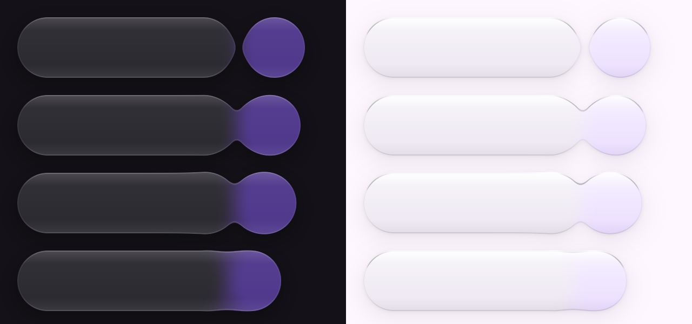
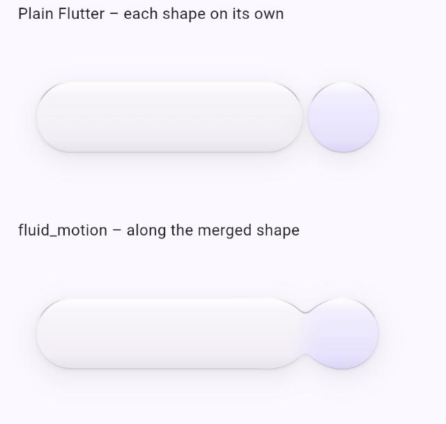
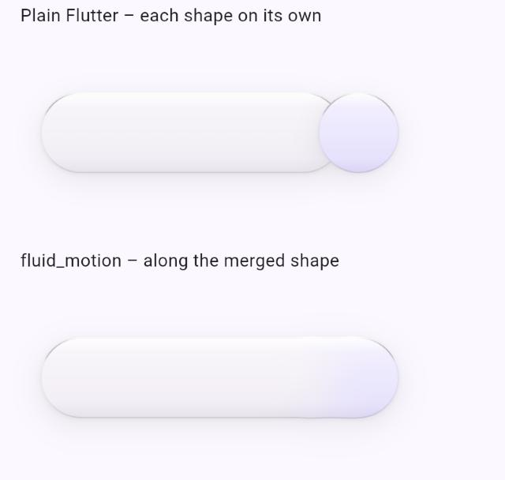
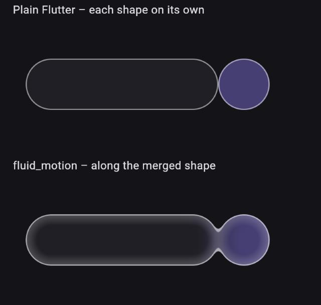

# Status

Where things stand (version 0.4.0, October 2026). Update this file when
something here changes.

## Ready

- Used from an app as a git dependency pinned to a tag (see README).
- Analyzer clean, 67 tests in the package and 6 in the example.
- "Reduce motion": `PressScale` and `GooeyStage` follow it by themselves;
  `DragSpringController` and `SegmentSpring` take it as a property (no
  context). See the README section.
- Edge light along the merged shape (`GooeyLight`, 0.4.0): Safari on an
  iPhone showed no measurable cost (L1 below).
- Measured on an iPhone 11: native iOS about 4.4 ms per frame with the GPU;
  web in Safari runs smoothly after the first fold (see the known issue).

## Open

| Item | What | Notes |
|---|---|---|
| P1 | One shared frame-time measurer instead of one callback per `MotionQuality` | Persistent frame callbacks cannot be removed, only muted |
| R1 | Test native Android on a real phone, GPU and CPU | Only iOS and web tested |
| Docs | GIF or video at the top of the README | |
| L1 | Edge light: measure again before production – charged, cool phone, 2–3 runs per setting, native too | Safari 2026-10-21: no measurable difference (see §6). Erik: before production, not before the tag |
| L3 | `MotionQuality` drops the shadow first, then the edge light | |
| L4 | Edge light on the CPU fallback | Today the CPU path draws the shapes without it |
| L5 | `MotionWarmUp` draws the shadow mode and a lit surface | Same program, so probably not needed – check the Safari first fold |
| L6 | Edge over the content, as an option | Today the edge is part of `GooeySurface`'s background, so the shape's content covers it (see "Edge and content" below) |

## Edge light along the merged shape (investigation 2026-10-20, released in 0.4.0)

Erik 2026-10-20: *"Vil du hjælpe med at finde ud af om vi kan få pakken til
at understøtte effekter som border og lyskanten"* – and the goal: it should
*"komme til at ligne det som er i produktion i dag så godt som muligt"*, but
as a general building block, usable *"til alle mulige ting forskellige
steder"*, not hard-coded to one app.

Asked by the events app: its bottom bar has a rim light (a 1 px edge
lightest at the top and bottom, a faint inner glow there, a fill a little
lighter at the top and a soft shadow), and gooey and that light cannot both
paint the same surface. When the shapes flow together, the edge must follow
the merged shape. Only its numbers are used here; nothing else from the app.

Built on branch `prototype/edge-light`, merged and released in 0.4.0 (GPU
only).
Measured: likeness against plain Flutter (below), and Erik's iPhone in
Safari (§6): no measurable cost.



**1. Short answer**

1. **Yes.** `GooeyLight` is a general building block in `GooeyStyle(light:)`:
   an edge with a gradient, a fill gradient, an inner glow from both ends of
   a gradient axis, an inner glow along the whole outline, and shadows. Every
   measure and colour is a parameter; every part is optional; it works with
   every outline. The default is a hairline edge.
2. **The edge follows the merged shape**: it is a band of the merged
   distance, so it runs on along the neck and vanishes where the shapes have
   flowed together, with no seam between neck and shapes.
3. **It looks like the plain Flutter version while the shapes are apart**:
   mean difference 0.4 (dark) and 0.9 (light) of 255 per channel. The
   example's "rim light" recipe uses the events app's numbers.
4. **Cost**: estimated edge, glow and gradient ≈ 1.4× today's gooey pixel
   work, with a soft shadow ≈ 3×. Measured on Erik's iPhone in Safari: no
   difference between off, edge light, and edge light + shadow (§6) – but
   the bar was not smooth in any of the three runs.
5. **Limits**: GPU only; the edge lies under the shape's content; one
   shadow pass merges at most four shapes.

**2. The building block**

```dart
GooeyStyle(
  light: GooeyLight(
    edgeWidth: 1,                         // 0 = no edge
    edgeColors: [...], edgeStops: [...],  // 1–4 stops along the axis
    begin: Alignment.topCenter,           // the gradient axis, in each
    end: Alignment.bottomCenter,          // shape's own rect
    fillStart: ..., fillEnd: ...,         // laid over the fill at each end
    glowStart: ..., glowEnd: ..., glowDepth: 12,  // inner glow from the ends
    outlineGlow: ..., outlineGlowDepth: 8,        // inner glow along the outline
    shadows: [BoxShadow(...)],            // under the merged shape
  ),
)
```

All colours are laid over each shape's own (blended) colour, so one light
fits every shape in a scene. `copyWith` and `shadowsOnly` derive variants.
The example's `EdgeLightRecipe` shows four looks from the same block: rim
light, hairline, strong glow, shadow only – each picked from how light the
fill is.

**3. Likeness to plain Flutter** (the example's Edge light demo:
`FlatLight` draws the same `GooeyLight` one shape at a time with a decorated
box, a glow painter and a stroked edge; the rim-light recipe; bar 240 × 64
and button 64; `surfaceContainer` and `primaryContainer`; 2× pixels).

| Apart (gap 24) | Mean difference (0–255) | Largest | Pixels off by more than 8 |
|---|---|---|---|
| Dark | 0.43 | 34 | 0.09 % |
| Light | 0.94 | 20 | 1.73 % |

The differences are in the shadow's halo and the edge's anti-aliasing. The
shadow comes from the distance (a logistic fit to a Gaussian), so it is a
touch darker at the round ends than Flutter's blur. `example/test/
edge_light_match_test.dart` measures this (in the test renderer, whose blur
is harder than CanvasKit's; checked by eye in Chrome as well).

**4. What changes when the shapes flow together**

| | Plain Flutter (each shape) | Along the merged shape |
|---|---|---|
| Edge where they meet | Two edges cross each other | The edge runs along the neck's outline; where they overlap there is no edge |
| Edge colour in the neck | – | Blended between the shapes. The neck's waist lies lower than the shapes' tops, so the edge there is about as faint as on the sides (stop 0.3) |
| Glow from the ends | Stops at each shape | Continuous; in a narrow neck it starts below the shapes' tops, so it looks thinner there |
| Fill gradient | Each shape its own | Blended, no seam |
| Shadow | Two shadows add up, darker under the overlap | One shadow under the merged shape |
| Just before touching | Nothing | The bumps reach out, and the edge follows them |
| Fully merged | A seam where one shape lies on the other | One shape; along the top and bottom of the seam the neck's fillet makes the outline bulge a little, and the edge follows |





**Edge and content.** The edge, glows and gradient are painted by
`GooeySurface` as the shape's background, so whatever the app puts on top
(`GooeySurface(child:)`, `GooeyContent`, or a widget stacked over the shape)
covers them. A plain Flutter version usually strokes the edge in a
foreground painter, OVER the content. It only matters where content reaches
the outline: a full-bleed child (e.g. a `NavigationBar` with its own
opaque background, an image or a selected pill touching the edge) hides the
edge there. For an app switching over: give that content a transparent
background, or keep it a few px inside the outline. If that is not enough,
L6 adds a foreground layer (`GooeyEdge`, the edge band only, in its own
painter over the content) – the same shader, one more pass over the
outline.

**5. Cost**

The panel's numbers in Chrome on the Mac are noise for this (raster 37 ms
with everything off in one run, 1.9 ms with everything on in the next), and
on the web the GPU's time does not show in "raster" anyway. So this is an
estimate from the work per pixel and the pixel areas on an iPhone 11
(2 device pixels per point, the bottom bar demo's bar 358 × 56 pt):

| | Pixels | Work per pixel | vs today's gooey |
|---|---|---|---|
| Surfaces today | ≈ 80 000 | 1 distance + ripples, neighbour near contact | 1× |
| + edge, glows, gradient | same | + 5 blends, 1 smooth-min per neighbour | ≈ 1.4× |
| + one soft shadow (blur 18) | + ≈ 211 000 | 2 distances, 1 exp | ≈ 3× |
| + two shadows | + ≈ 311 000 | as above, twice | ≈ 4–5× |

The shader is about 45 % larger (SkSL 31 kB against 21 kB). Same program,
compiled once at the warm-up, but it may lengthen the Safari first-fold
hitch (Known issues). If the shadow is too heavy (L2): Flutter's own
`BoxShadow` per shape while apart, the shader's shadow only while connected,
and several shadows in one pass.

**6. Measured (L1)** – Erik's iPhone 11 (confirmed by Erik 2026-10-21; the
device the cost estimate in §5 is worked out for), Safari, 2026-10-21 14:58–15:01, battery 40 %. The example built
from `c465e94`, Bottom bar demo, panel: Automatic quality off, Reset, fold
and unfold five times. One run each. Native not measured.

| Run | build + raster | 90 % | over 16 ms | fps | jank | worst gap | heaviest frame |
|---|---|---|---|---|---|---|---|
| 1. Both toggles off | 8.6 + 11.0 ms | 30.0 ms | 52 % | 42 | 50 % | 212 ms | 202 ms (build 10 + raster 192) |
| 2. Edge light | 8.0 + 10.8 ms | 27.0 ms | 59 % | 41 | 61 % | 207 ms | 202 ms (10 + 192) |
| 3. Edge light + shadow | 7.7 + 11.0 ms | 26.0 ms | 56 % | 40 | 61 % | 210 ms | 205 ms (13 + 192) |

What it says:

1. **No measurable cost from the edge light or the shadow.** Raster stays
   at about 11 ms and fps at 40–42 in all three. On the web the GPU's time
   does not show in "raster", so fps and jank are the numbers that count:
   fps falls by 1–2 and jank rises from 50 to 61 %, within what one run per
   setting can tell apart.
2. **The bar itself was not smooth** – 40–42 fps and half the frames over
   16 ms with everything off. Earlier measurements (Ready, above) had
   Safari smooth after the first fold. A phone at 40 % that is not cool, or
   one run per setting, may explain it; so the question "is it smooth?" is
   not answered by this, only "does the light make it worse?" (no).
3. **The 192 ms raster frame is the same in all three** – it looks like the
   Safari first-fold hitch (Known issues), not the light. It appears in
   every run, so the page was probably reloaded between runs.
4. **Still open:** native, and a charged, cool phone with a few runs per
   setting, before the light goes into a release.

**7. Decided (Erik 2026-10-21: *"kør anbefalingen"*)**

1. Gooey **and** rim light on the same surface: yes.
2. One light for the whole scene. Per shape (`GooeyMember(light:)`) only if
   a need shows up.
3. The exact shadow under the merged shape. L2 (cheaper shadow) is dropped.
4. The new measurement (charged, cool phone, 2–3 runs per setting) comes
   before production, not before the tag (L1).

**8. Related:** the events app's `FLUID_MOTION.md` §6 and §8.4 and its
`DESIGN.md` §5.1 (where the rim light's numbers come from).

## Known issues

**Safari, first fold hitch.** On an iPhone 11 in Safari, the first time the
bottom bar folds after the page loads, one frame takes about 200 ms (build
about 15 ms, raster about 180 ms). Afterwards it is smooth. Measured with the
debug panel's "heaviest frame". What was ruled out, with measurements:

| Tried | Result |
|---|---|
| Hide icons and text | Still about 180 ms raster – not the content |
| Hide the bar (list only) | 35 ms, raster 5 – it is the bar |
| Draw on GPU off | Raster 2 ms – it is the GPU path… |
| …but `MotionWarmUp` already draws the shader, and a tiny real gooey scene in the warm-up did not help | Not the shader program itself |
| Priming the neck's own shader instance while apart | No change |

Not tried yet: the effect toggles one at a time (Gooey neck / Blob / Colour
blend in the panel) with the GPU on. Worth doing only if the hitch shows up
in the real app.

**CPU fallback, first fold.** With "Draw on GPU" off, the first fold costs
about 2 s of build (Dart). The CPU path only runs when the shader cannot
load, but this should be found and fixed before relying on it.

## Decisions and things that did not work

- Content (`GooeyInfluence`) without its own layers while unaffected: correct
  and tested, but no measurable gain on the iPhone, so it was dropped to keep
  the code simple.
- An early "worst" number in the debug panel counted idle pauses as hitches;
  fixed (`worst gap` only counts gaps while animating). Older measurements
  of fps and jank in notes are not reliable.
- Flutter 3.41 and 3.47 measured the same; today's frame cost is not a
  regression from the upgrade.
- wasm/skwasm: white screen in Safari; the web build stays on CanvasKit.
- "Reduce motion" (A1, 0.3.0): the drag controller still glides (critically
  damped) instead of jumping, because the fold follows the user's own scroll
  or drag. Controllers without a context are not made automatic (no hidden
  global state); the owning widget sets `reduceMotion`.
